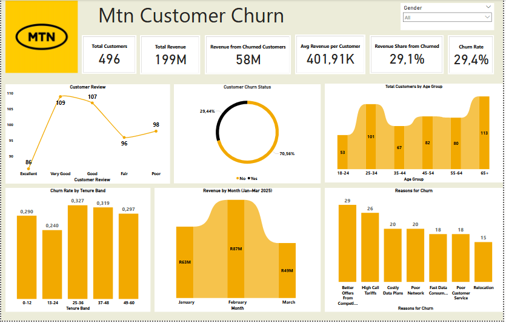
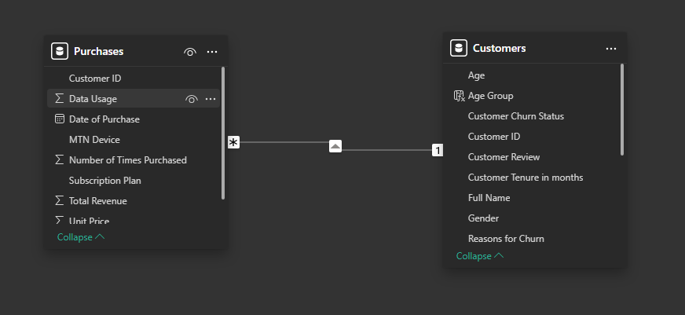
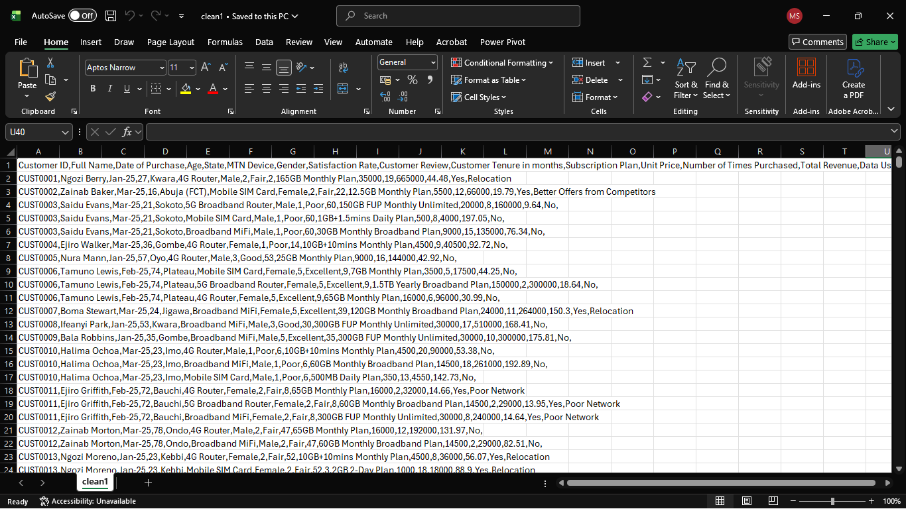
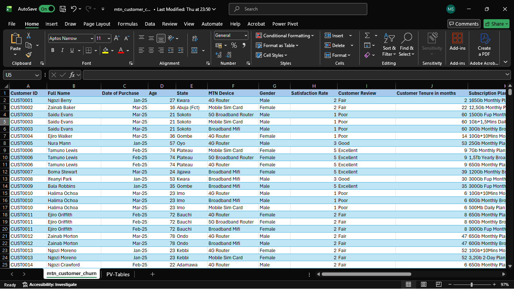

# MTN Customer Churn Analytics Dashboard — Power BI

## Overview
An end-to-end Power BI project analysing churn in a telecom customer base. The data holds 974 purchase lines belonging to **496 customers**, of whom **146 (29.4%) churned**. The dashboard shows how many customers left, why they left, how much revenue they represent, and whether churn varies by tenure, age or satisfaction.

The main challenge was not missing data. The dataset has one row per customer purchase, not one row per customer, which means a naive count of customers, churn or revenue is wrong. Most of the work went into modelling the data correctly and checking every figure against the raw totals.

## Dashboard






## Business Questions Addressed
- How many customers are there, and what share churned?
- How much revenue do churned customers represent?
- Why do customers leave?
- Does churn vary by tenure?
- How are customers distributed by age group and satisfaction?

## Data Model
The source table has 974 rows and 17 columns. In Power Query it is split into two tables that share a one-to-many relationship on `Customer ID` (single direction):

- **Customers (496 rows, one per customer):** Customer ID, Full Name, Age, State, Gender, Satisfaction Rate, Customer Review, Customer Tenure in months, Customer Churn Status, Reasons for Churn. These fields are identical on every row of a customer, which was verified before removing duplicates.
- **Purchases (974 rows, one per purchase line):** Customer ID, Date of Purchase, MTN Device, Subscription Plan, Unit Price, Number of Times Purchased, Total Revenue, Data Usage. These fields differ between a customer's lines.

Customer metrics (counts, churn, demographics) come from **Customers**. Revenue metrics come from **Purchases**.

## Data Profiling
- **Rows are purchase lines, not customers.** 974 rows belong to 496 unique customers (1 to 3 lines each).
- **Customer IDs are unique per customer, but names are not.** Twelve names are shared by 24 different customers.
- **No duplicate rows.** Category labels are consistent, and there are no disguised nulls.
- **Revenue is internally consistent.** `Total Revenue = Unit Price × Number of Times Purchased` holds on all 974 rows.
- **Churn status:** 146 customers churned and 350 did not.
- **Structural nulls:** `Reasons for Churn` is blank only for customers who did not churn. All 146 churned customers have a reason.
- **Date of Purchase** is month-year text (`Jan-25`, `Feb-25`, `Mar-25`), covering only three months: Jan 271 lines, Feb 450, Mar 253.
- **Satisfaction Rate and Customer Review say the same thing** (1 = Poor, 2 = Fair, 3 = Good, 4 = Very Good, 5 = Excellent).
- **Data Usage looks unrelated to the plan.** It exceeds the plan allowance in 582 of 974 rows (assuming GB), and the unit is not stated.

## Data Challenges and Decisions
- **One row per purchase, not per customer.** Counting rows would inflate customers and churn (284 "churned" rows against 146 churned customers). *Decision:* split the data into Customers and Purchases and count distinct customers.
- **Counting customers by name.** `COUNTA(UNIQUE(Full Name))` gives 484, because names collide. *Decision:* count unique Customer ID, which gives 496.
- **Dates corrupted on import.** Excel read `Jan-25` as 25 January 2026, so every row landed on the 25th of 2026. The source CSV and the fact that there are only three distinct values show the "25" is the year. *Decision:* rebuild the date as the first of the month in 2025 (`DATE(2025, MONTH(...), 1)`) and display month only.
- **Over-cleaning.** Applying `PROPER` to every column turned "SIM", "MiFi", "FCT", "GB" and "FUP" into "Sim", "Mifi", "Fct", "Gb" and "Fup". *Decision:* restore the original labels, apply `PROPER` to names only, and correct the typo "Tarriffs" to "Tariffs".
- **Structural nulls in Reasons for Churn.** Blanks mean "did not churn", not "missing". *Decision:* fill with N/A and exclude N/A from the reasons analysis.
- **A duplicate-removal step applied too early.** Removing duplicates in the shared base query cut Purchases to 496 rows and halved revenue (96M instead of 199M). Reconciling the dashboard against the raw total exposed it. *Fix:* remove duplicates only in the Customers query, then rebuild the relationship as one-to-many.
- **Data Usage.** Because it does not respect plan size, it is excluded from all conclusions.

## Process
1. **Profiling:** checked duplicates, nulls, keys and internal consistency.
2. **Cleaning in Excel:** standardised text, rebuilt the dates and documented each decision.
3. **Modelling in Power Query:** built the Customers and Purchases tables from one base query and related them on Customer ID.
4. **Measures in DAX:** wrote the KPI measures and the age and tenure groupings.
5. **Verification:** checked every figure against known totals (496 customers, 146 churned, 974 lines, 199,348,200 revenue) before building visuals.
6. **Visualisation:** built the dashboard in MTN yellow and black.

## DAX

**Calculated columns on Customers**
```dax
Age Group =
SWITCH(TRUE(),
    Customers[Age] < 25, "18-24",
    Customers[Age] < 35, "25-34",
    Customers[Age] < 45, "35-44",
    Customers[Age] < 55, "45-54",
    Customers[Age] < 65, "55-64",
    "65+")

Tenure Band =
SWITCH(TRUE(),
    Customers[Customer Tenure in months] <= 12, "0-12",
    Customers[Customer Tenure in months] <= 24, "13-24",
    Customers[Customer Tenure in months] <= 36, "25-36",
    Customers[Customer Tenure in months] <= 48, "37-48",
    "49-60")
```

**Measures**
```dax
Total Customers = DISTINCTCOUNT(Customers[Customer ID])

Churned Customers =
CALCULATE([Total Customers], Customers[Customer Churn Status] = "Yes")

Churn Rate = DIVIDE([Churned Customers], [Total Customers])

Total Revenue = SUM(Purchases[Total Revenue])

Revenue from Churned Customers =
CALCULATE([Total Revenue], Customers[Customer Churn Status] = "Yes")

Revenue Share from Churned = DIVIDE([Revenue from Churned Customers], [Total Revenue])

Avg Revenue per Customer = DIVIDE([Total Revenue], [Total Customers])
```

Customers are counted with `DISTINCTCOUNT` of Customer ID, never by rows or by name.

## Dashboard Visuals
- **KPI cards:** Total Customers, Total Revenue, Revenue from Churned Customers, Avg Revenue per Customer, Revenue Share from Churned, Churn Rate
- **Customer Review:** customers by review
- **Customer Churn Status:** donut chart
- **Total Customers by Age Group**
- **Churn Rate by Tenure Band**
- **Revenue by Month (Jan–Mar 2025)**
- **Reasons for Churn:** sorted from high to low
- **Slicer:** Gender

## Key Insights
- **Churn is 29.4%.** 146 of 496 customers left.
- **Churned customers represent 29.1% of revenue** (58M of 199M), roughly in line with their share of customers. Average revenue per customer is 401.91K.
- **Pricing drives about half of churn.** Better Offers from Competitors (29), High Call Tariffs (26) and Costly Data Plans (20) make up 75 of 146 reasons (51%).
- **Network and service problems account for another 26%.** Poor Network (20) and Poor Customer Service (18) make up 38 reasons. The rest are Fast Data Consumption (18) and Relocation (15).
- **Churn is flat across tenure.** It ranges only from 24.0% (13-24 months) to 32.7% (25-36 months), with no clear pattern, so tenure does not predict churn here.
- **Satisfaction does not predict churn either.** Customers who rated 5 churn the most (about 36%).
- **Customers skew older and young adult.** The 65+ group is the largest (113 customers), followed by 25-34 (101), and 18-24 is the smallest (53).
- **February is the strongest revenue month** (87M, against 63M in January and 49M in March), but it also has far more purchase lines (450 vs 271 and 253).

## Recommendations
- **Compete on price.** Half of all churn reasons are about offers, tariffs and data plan cost, so targeted retention offers or price matching would address the largest group.
- **Review tariffs and data plan value** for customers at risk, since three of the top four reasons are price-related.
- **Invest in network quality and customer service,** which together explain about a quarter of churn.
- **Don't rely on satisfaction scores alone** to flag at-risk customers, since they show no link to churn in this data.

## Limitations
- **Only three months of data** (Jan–Mar 2025), so no trends can be read from it.
- **Churn status is a snapshot,** with no date of churn.
- **The patterns look synthetic.** Churn does not follow satisfaction, tenure or device, so findings describe this dataset only.
- **Data Usage is unreliable** and was excluded.
- **Revenue by plan and device is not analysed on this page.**
- **Names are not unique,** so customers must be identified by Customer ID.

## Tools Used
Power BI Desktop (Power Query, data modelling, DAX, slicers), Microsoft Excel (data cleaning and documentation)

## Notes on Data
Source: [https://www.kaggle.com/datasets/oluwademiladeadeniyi/mtn-nigeria-customer-churn)]

## Author
**Sello Mpho** · Bloemfontein, South Africa
[Portfolio](https://mpho-sello.vercel.app/) · [LinkedIn](https://www.linkedin.com/in/mpho-sello-692193241) · sellompho1601@gmail.com
